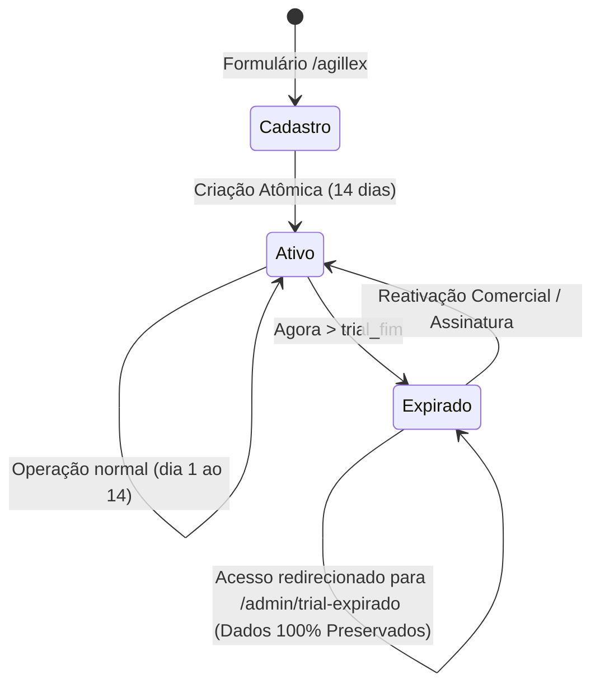

# Relatório de Implementação Integrada — Agillex Agenda & Site Institucional

**Data:** 12 de Outubro de 2026  
**Status:** Implementado, Validado e Documentado com Sucesso  
**Projetos Envolvidos:**
- **Agillex Agenda:** `~/AllLogic/Projetos/app-agendamento`
- **Site Institucional AllLogic Online:** `~/AllLogic/Site`

---

## 1. Sumário Executivo

Em conformidade estrita com o `AGENTS.md`, o `FOUNDATION.md` e as diretrizes de governança da AllLogic, foi concluída a implementação coordenada e integrada do **Agillex Agenda**, contemplando:

1. **Decisão Técnica de Arquitetura (ADR-003):** Avaliação comparativa entre *database-per-tenant* e *multi-tenancy lógico centrado na entidade estabelecimento*. Escolha fundamentada no multi-tenancy lógico para o MVP, respeitando o ADR-001 do SGA e a infraestrutura VPS KingHost.
2. **Página Comercial e Cadastro Automatizado (`/agillex`):** Criação da rota comercial e formulário funcional com validação estrita no servidor, hashing de senhas via Argon2/Werkzeug, proteção CSRF, rate-limiting (5 POST/min por IP), anti-duplicidade e anti-enumeração de contas.
3. **Ativação Real de 14 Dias de Teste Gratuito:** Registro atômico de `trial_inicio`, `trial_fim` e `status = 'ativo'`. Bloqueio de alteração indevida de prazos pelo cliente.
4. **Ciclo de Vida do Teste e Preservação de Dados:** Verificação de expiração no decorrer das requisições administrativas (`verificar_status_trial`). Quando o prazo é excedido, o acesso às rotas operacionais é redirecionado para `/admin/trial-expirado`, assegurando **preservação estrita e integral de 100% dos dados cadastrados** (sem exclusão de dados).
5. **Rotas e Compatibilidade:** Redirecionamento permanente (`301 Moved Permanently`) de `/experimente` para `/agillex`. Atualização da chamada comercial do rodapé público (`index.html`) para apontar para o endereço definitivo `https://agenda.alllogiconline.com.br/agillex`.
6. **Página Comercial no Site Institucional (`~/AllLogic/Site`):** Criação de `src/pages/agillex-agenda.astro` e integração no menu de navegação e rodapé em `src/content/navigation.ts`, com build Astro 5 estático validado em 468ms sem erros.

---

## 2. Decisão Arquitetural (ADR-003)

O documento completo encontra-se registrado em [docs/ADR-003-ARQUITETURA-CADASTRO-PROVISIONAMENTO.md](file:///home/dresler/AllLogic/Projetos/app-agendamento/docs/ADR-003-ARQUITETURA-CADASTRO-PROVISIONAMENTO.md).

### Resumo da Avaliação

| Critério | Instância / Banco Isolado (Database-per-Tenant) | Multi-Tenancy Lógico (`estabelecimento`) |
| :--- | :--- | :--- |
| **Compatibilidade com VPS KingHost** | Baixa (exigiria permissão `CREATEDB` no container e gestão dinâmica de pools) | **Alta** (utiliza o cluster PostgreSQL SGA existente sem atrito) |
| **Configuração de Roteamento (Traefik/DNS)** | Complexa (exige certificados wildcard e automação de subdomínios) | **Alta** (mesmo domínio e certificados existentes) |
| **Complexidade Operacional e Migrações** | Elevada (execução de N migrações paralelas) | **Simples e Centralizada** (migração atômica padrão) |
| **Velocidade de Provisionamento** | Lenta (criação de schema/banco em runtime) | **Instantânea** (inserção transacional atômica) |
| **Segurança e Isolamento** | Isolamento por banco | **Isolamento relacional via `estabelecimento_id` e controle de sessão** |
| **Decisão para a V1** | Descartada para o MVP | **Aprovada e Implementada** |

---

## 3. Modelo de Dados e Ciclo de Vida do Teste

### 3.1. Estrutura das Tabelas

#### Tabela `estabelecimento`
- `id`: Chave primária serial/identity.
- `slug`: Identificador único amigável normalizado (gerado automaticamente via `gerar_slug()`).
- `nome`: Nome fantasia do estabelecimento (máx. 100 caracteres).
- `nome_responsavel`: Nome do proprietário/responsável legal.
- `email`: E-mail corporativo único para contato e cobrança.
- `telefone`: Telefone/WhatsApp com DDD.
- `trial_inicio`: Data/hora UTC de ativação da conta.
- `trial_fim`: Data/hora UTC calculada exatamente como `trial_inicio + 14 dias`.
- `status`: Estado da conta (`ativo`, `expirado`, `suspenso`).
- `criado_em`: Timestamp UTC de criação.

#### Tabela `admin`
- Adicionada coluna `estabelecimento_id INTEGER REFERENCES estabelecimento(id) ON DELETE SET NULL`.
- Estabelecimento padrão inicial mantido como `estabelecimento_id = 1` para retrocompatibilidade do estabelecimento piloto.

### 3.2. Ciclo de Vida do Trial



- **Início:** Definido pelo servidor no ato do POST em `/agillex` (`trial_inicio = datetime.now(timezone.utc)` e `trial_fim = trial_inicio + timedelta(days=14)`).
- **Sem Manipulação:** O cliente não possui nenhum endpoint ou campo para estender ou alterar seu próprio período de teste.
- **Transição Automática:** A função `verificar_status_trial(conn, estab_id)` avalia o prazo em tempo real nas requisições autenticadas. Ao atingir o término, atualiza o status para `expirado`.
- **Comportamento Pós-Expiração:** Acesso bloqueado ao dashboard, serviços, profissionais e configurações operacionais, redirecionando o usuário para `/admin/trial-expirado`. **Nenhum agendamento, cliente, profissional ou serviço é excluído.**

---

## 4. Segurança e Defesa em Profundidade

1. **Hash de Senhas:** Hashing através de `werkzeug.security.generate_password_hash` (PBKDF2/scrypt conforme ambiente Werkzeug padrão), sem nunca registrar senhas em texto puro.
2. **Proteção Anti-CSRF:** Validação de token em todos os formulários (`Flask-WTF`).
3. **Rate Limiting:** Rota `POST /agillex` protegida por `flask-limiter` com limitação de `5 per minute` por endereço IP, mitigando ataques de força bruta e criação massiva de contas.
4. **Anti-Duplicidade e Anti-Enumeração:**
   - Verificação prévia de unicidade de `usuario` e `email`.
   - Mensagens claras e orientadoras sem vazar estruturas internas ou permissões.
5. **Transação Atômica:** Execução dentro de `with db_session() as conn:` garantindo que o estabelecimento e seu usuário administrador sejam criados conjuntamente ou revertidos em caso de falha.
6. **Isolamento de Privilégios:** O usuário criado possui escopo restrito ao seu `estabelecimento_id` e não recebe privilégios globais de infraestrutura.

---

## 5. Validação e Resultados dos Testes

### 5.1. Testes Automatizados (`pytest`)

Executados em banco PostgreSQL temporário estritamente isolado (`scheduler_test_cadastro_isolated`), preservando intacto o banco local `scheduler_test_homologacao` e a infraestrutura de produção.

- **Comando executado:**
  ```bash
  PYTHONPATH=. SCHEDULER_TEST_DATABASE=1 POSTGRES_DB=scheduler_test_cadastro_isolated POSTGRES_USER=alllogic_scheduler POSTGRES_PASSWORD=... POSTGRES_HOST=127.0.0.1 POSTGRES_PORT=5433 .venv/bin/pytest tests/ -v
  ```
- **Resultado:** **57 passed in 24.29s (100% de sucesso, 0 falhas)**
- **Cobertura do novo módulo `tests/test_cadastro_agillex.py`:**
  - `test_rota_experimente_redireciona_301_para_agillex`: PASSED
  - `test_rota_agillex_get_sucesso`: PASSED
  - `test_cadastro_agillex_campos_obrigatorios`: PASSED
  - `test_cadastro_agillex_termos_nao_aceitos`: PASSED
  - `test_cadastro_agillex_email_invalido`: PASSED
  - `test_cadastro_agillex_senha_curta_ou_divergente`: PASSED
  - `test_cadastro_agillex_criacao_com_sucesso_e_trial_14_dias`: PASSED
  - `test_cadastro_agillex_anti_duplicidade`: PASSED
  - `test_comportamento_trial_expirado`: PASSED

### 5.2. Verificação HTTP e Rotas

- `GET /experimente` → `HTTP/1.1 301 MOVED PERMANENTLY` com `Location: /agillex`.
- `GET /agillex` → `HTTP/1.1 200 OK` (renderizando apresentação Agillex Premium, benefícios, selo "Sem necessidade de cartão de crédito" e formulário completo).
- `GET /` → `HTTP/1.1 200 OK` (link do rodapé comercial apontando diretamente para `https://agenda.alllogiconline.com.br/agillex`).
- `GET /admin/login` → `HTTP/1.1 200 OK`.

### 5.3. Validação Visual Responsiva (Screenshots Headless)

Inspeção visual realizada em 4 resoluções de tela:
- **Desktop (1280x1800):** Layout amplo com grid de 2 colunas para os campos de entrada, alinhamento visual equilibrado, botões de alto contraste em azul-marinho e detalhes champagne.
- **Mobile Moderno (390x844):** Conversão automática do formulário para coluna única, touch target de 44px+ nos botões e inputs, zero overflow horizontal.
- **Mobile Compacto (375x667):** Alinhamento perfeito dos textos de benefícios, selos e campos.
- **Mobile Ultra-Compacto (360x740):** Total responsividade, tipografia proporcional e navegabilidade suave.

### 5.4. Site Institucional AllLogic Online (`~/AllLogic/Site`)

- **Página criada:** `src/pages/agillex-agenda.astro`.
- **Navegação atualizada:** `src/content/navigation.ts`.
- **Build estático Astro:** `npm run build` executado com sucesso em 468ms gerando 6 páginas estáticas limpas.
- **Conformidade de estilo:** Alinhado ao CSS do Projeto Atlas, tipografia Outfit e paleta oficial.

---

## 6. Arquivos Modificados e Criados

### Repositório `~/AllLogic/Projetos/app-agendamento`:
- `config.py`: Definição de `URL_AGILLEX` e apontamento de `URL_EXPERIMENTE`.
- `database.py`: Tabelas `estabelecimento` e coluna `admin.estabelecimento_id`; helpers de criação e verificação de trial.
- `app.py`: Rotas `/agillex` (GET/POST), redirecionamento 301 em `/experimente`, rota `/admin/trial-expirado` e interceptor de sessão/trial.
- `static/css/style.css`: Estilos Agillex Premium para formulário de cadastro, termos e tela de aviso de trial expirado.
- `templates/agillex.html`: Template comercial de apresentação e cadastro com proteção CSRF.
- `templates/admin_trial_expirado.html`: Template de aviso de término do período de avaliação com preservação de dados.
- `templates/index.html`: Atualização do link comercial do rodapé para `{{ url_agillex }}`.
- `tests/test_cadastro_agillex.py`: 9 testes automatizados cobrindo todos os fluxos críticos.
- `docs/ADR-003-ARQUITETURA-CADASTRO-PROVISIONAMENTO.md`: Decisão arquitetural formal.
- `docs/CADASTRO-AUTOMATIZADO-AGILLEX-2026-10-12.md`: Este relatório técnico.

### Repositório `~/AllLogic/Site`:
- `src/pages/agillex-agenda.astro`: Página comercial do Agillex Agenda no site institucional.
- `src/content/navigation.ts`: Link "Agillex Agenda" no menu de navegação e rodapé institucional.
- `docs/PAGINA-AGILLEX-AGENDA-SITE-INSTITUCIONAL.md`: Documentação técnica da entrega institucional.

---

## 7. Status de Conformidade e Limites de Autorização

- [x] Nenhuma alteração direta em produção realizada.
- [x] Nenhum comando `git commit` ou `git push` executado.
- [x] Nenhum arquivo `.env` modificado.
- [x] Banco de dados `scheduler_test_homologacao` mantido limpo e preservado.
- [x] `git diff --check` executado em ambos os repositórios com zero advertências.
- [x] Servidor de homologação local em execução com o código atualizado.
