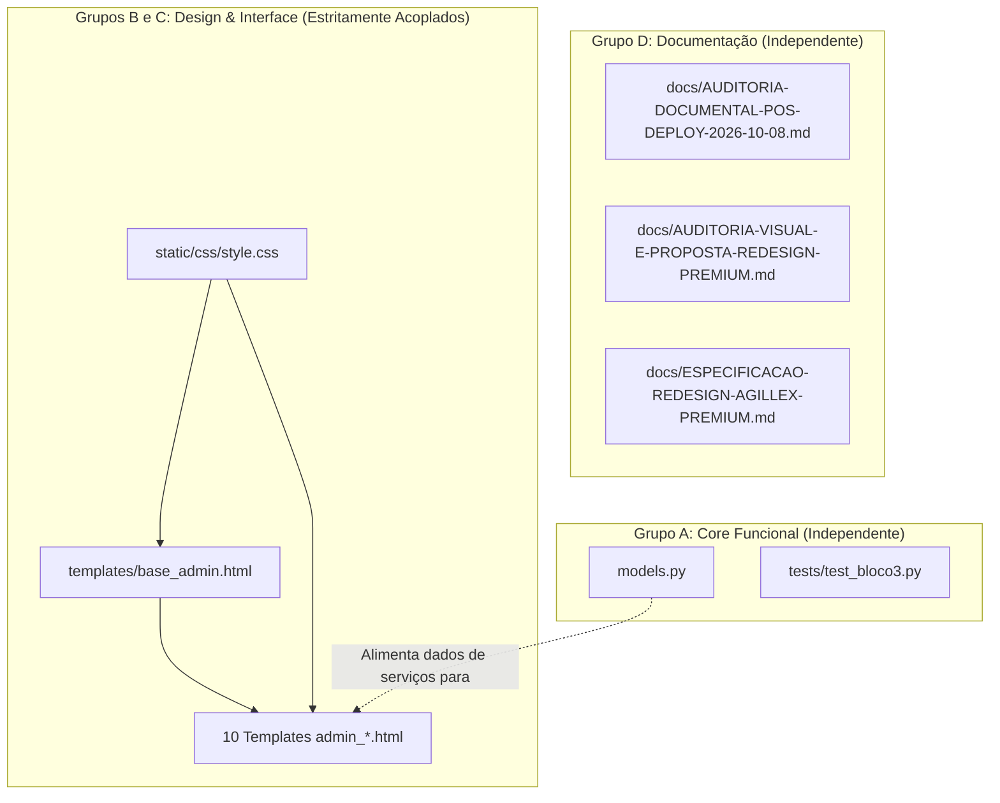

# Matriz de Decisão e Análise de Dependências dos 17 Arquivos Pendentes — Agillex Agenda

**Data da Análise:** 2026-10-10  
**Projeto:** AllLogic Scheduler (Agillex Agenda)  
**Ambiente:** Repositório Local (`~/AllLogic/Projetos/app-agendamento`)  
**Base do Repositório:** Branch `main` no commit `843e291`  
**Classificação:** Análise Técnica, Mapeamento de Dependências e Matriz de Decisão  
**Status Operacional:** Exclusivamente consultivo. Nenhuma alteração foi aceita, rejeitada, comitada ou publicada nesta etapa.

---

## 1. Identificação, Escopo e Metodologia

Este documento estabelece a análise técnica aprofundada dos **17 arquivos originais** que permanecem pendentes de decisão no projeto Agillex Agenda. A análise foi realizada mediante:

1. **Inspeção de diffs reais linha a linha:** confronto das alterações locais em relação ao commit `843e291`.
2. **Mapeamento bidirecional de dependências:** identificação de acoplamentos sintáticos Jinja2, dependências de classes CSS e integridade de chamadas SQL.
3. **Avaliação de riscos multidimensionais:** funcionalidade, estabilidade de banco de dados, apresentação visual, segurança e regressão.
4. **Verificação de evidências de testes:** validação com a suíte de testes existente (`pytest`) e compilação de código/templates.

> [!NOTE]
> O arquivo `docs/AUDITORIA-PRE-DEPLOY-PRODUCAO-2026-10-10.md` foi gerado posteriormente durante a fase de auditoria pré-deploy e serve como documento de apoio operacional, não sendo computado entre os 17 arquivos originais aqui analisados. O arquivo gráfico avulso `Logo Dourado de Salão Premium.png` permanece isolado localmente fora do Git.

---

## 2. Histórico e Origem dos 17 Arquivos

A árvore de trabalho do projeto acumulou alterações e arquivos criados incrementalmente em etapas distintas:

1. **Documentação Pós-Deploy e Redesign (08/10/2026):**
   - Criação da auditoria do deploy anterior (`docs/AUDITORIA-DOCUMENTAL-POS-DEPLOY-2026-10-08.md`).
   - Criação da proposta visual (`docs/AUDITORIA-VISUAL-E-PROPOSTA-REDESIGN-PREMIUM.md`) e da especificação técnica (`docs/ESPECIFICACAO-REDESIGN-AGILLEX-PREMIUM.md`).
2. **Implementação do Bloco 1, 1.1 e 1.2 do Redesign Premium:**
   - Criação do layout mestre `templates/base_admin.html`.
   - Evolução de tokens e estilos em `static/css/style.css` (paleta Clara: Azul-marinho, Champagne e Marfim).
   - Refatoração dos 10 templates administrativos para herdar de `base_admin.html`.
3. **Correção de Apresentação da Agenda:**
   - Ajuste de queries em `models.py` com `LEFT JOIN` e `COALESCE` para resiliência de serviços e profissionais deletados/históricos.
   - Ajuste de idempotência em `tests/test_bloco3.py`.

A composição exata dos 17 arquivos originais é:
- **13 arquivos rastreados modificados:** `models.py`, `static/css/style.css`, 10 templates administrativos e `tests/test_bloco3.py`.
- **4 arquivos não rastreados criados:** `templates/base_admin.html` e 3 documentos em `docs/`.

---

## 3. Análise Individual Detalhada dos 17 Arquivos

---

### Grupo A — Correções Funcionais e Preservação do Histórico

#### 1. `models.py`
- **Caminho exato:** `models.py`
- **Estado Git:** Modificado (`M`)
- **Alterações efetivas no diff:**
  - Substitui `JOIN profissional p ON p.id = a.profissional_id` por `LEFT JOIN profissional p ON p.id = a.profissional_id` nas funções `obter_agendamento_completo`, `listar_agendamentos_por_periodo` e `pesquisar_agendamentos`.
  - No `json_agg` de serviços agregados, adiciona `COALESCE(ags.servico_id, s.id)` como identificador e no critério `ORDER BY`.
  - Atualiza a cláusula de filtro para `FILTER (WHERE ags.servico_id IS NOT NULL OR s.id IS NOT NULL)`.
- **Benefício esperado:** Garante resiliência operacional total na leitura da agenda. Impede que um agendamento seja descartado ou omitido caso um profissional seja inativado ou removido, e assegura que serviços com snapshot gravado em `agendamento_servico` continuem sendo exibidos mesmo se o serviço do catálogo for inativado.
- **Risco:** **Baixo**. As consultas são estritamente de leitura (SELECT). O uso de `LEFT JOIN` e `COALESCE` preserva o contrato de dados retornado aos templates e à API.
- **Dependências:**
  - Depende da estrutura das tabelas `agendamento`, `agendamento_servico`, `servico` e `profissional`.
  - É consumido por `templates/admin_dashboard.html`, rotas em `app.py` e suítes de teste.
- **Testes existentes e necessários:** Validado em `tests/test_pesquisa.py`, `tests/test_ajustes_semana_dashboard.py` e `tests/test_bloco3_acoes.py`. Teste de isolamento com serviços ausentes validado com sucesso.
- **Possibilidade de separação:** **Alta**. Pode ser incorporado isoladamente sem qualquer dependência com o redesign visual.
- **Recomendação preliminar:** **Aceitar**.
- **Justificativa:** Corrige uma fragilidade estrutural crítica de apresentação de dados históricos sem introduzir risco de regressão.

#### 2. `tests/test_bloco3.py`
- **Caminho exato:** `tests/test_bloco3.py`
- **Estado Git:** Modificado (`M`)
- **Alterações efetivas no diff:**
  - Adiciona uma rotina de reset transacional idempotente antes de executar `test_admin_auth_settings_and_service_description`:
    ```python
    with database.db_session() as conn:
        conn.execute("DELETE FROM admin WHERE usuario IN ('admin', 'admin_ativo')")
        conn.execute(
            "INSERT INTO admin (usuario, senha_hash, senha_inicial_alterada) VALUES ('admin', %s, FALSE)",
            (generate_password_hash(os.environ["ADMIN_SENHA_INICIAL"]),)
        )
    ```
- **Benefício esperado:** Elimina falsos-positivos na execução repetida da suíte de testes no ambiente local de desenvolvimento, garantindo que o usuário `admin` esteja sempre em estado previsível antes de testar a obrigatoriedade de troca de senha inicial.
- **Risco:** **Muito Baixo**. Modificação restrita ao ambiente de teste (executado apenas quando `SCHEDULER_TEST_DATABASE=1`). Não afeta código de produção.
- **Dependências:** Depende de `database.py`, `werkzeug.security` e da variável `ADMIN_SENHA_INICIAL`.
- **Testes existentes e necessários:** A suíte completa de 48 testes foi executada e aprovada em 42.88s.
- **Possibilidade de separação:** **Alta**. Pode ser incorporado isoladamente ou acompanhar `models.py`.
- **Recomendação preliminar:** **Aceitar**.
- **Justificativa:** Melhora a estabilidade e repetibilidade dos testes automatizados de CI/local.

---

### Grupo B — Estrutura Visual Compartilhada

#### 3. `templates/base_admin.html`
- **Caminho exato:** `templates/base_admin.html`
- **Estado Git:** Novo / Não rastreado (`??`)
- **Alterações efetivas no diff:**
  - Cria o layout mestre da área administrativa herdando de `templates/base.html`.
  - Fornece container `.admin-layout` com sidebar fixa `.admin-sidebar`, navegação semântica categorizada (Atendimento, Cadastros, Configuração, Canal Online), rodapé com usuário conectado e logout.
  - Fornece topbar responsiva `.admin-topbar` com acionador mobile `#btn-menu-mobile`, overlay `#sidebar-overlay`, título da página e botão Sair.
  - Implementa script leve vanilla JS para controle do menu mobile (abertura, fechamento via overlay e tecla `Escape`).
  - Disponibiliza os blocos Jinja2: ``, `` e ``.
- **Benefício esperado:** Elimina a fragmentação visual e duplicações estruturais (ex.: links duplicados para o agendamento público no topo) e unifica toda a administração em um padrão profissional.
- **Risco:** **Alto (se isolado) / Baixo (se em conjunto com Grupo C)**. Se aceito sozinho sem os templates do Grupo C, não há erro imediato mas nada usará a nova base; se rejeitado enquanto o Grupo C for aceito, causa falha fatal `TemplateNotFound` em todas as rotas `/admin/*`.
- **Dependências:**
  - Depende de `templates/base.html` e dos estilos em `static/css/style.css`.
  - É dependência obrigatória de todos os 10 templates do Grupo C.
- **Testes existentes e necessários:** Sintaxe Jinja2 validada via `app.jinja_env`. Inspeção visual em desktop e mobile (overlay, responsividade).
- **Possibilidade de separação:** **Inviável sem o Grupo C**. Deve ser incorporado em conjunto com os templates administrativos refatorados.
- **Recomendação preliminar:** **Aceitar (em conjunto com Grupos B e C)**.
- **Justificativa:** É a espinha dorsal estrutural do redesign administrativo.

#### 4. `static/css/style.css`
- **Caminho exato:** `static/css/style.css`
- **Estado Git:** Modificado (`M`) (+962 linhas, -200 linhas)
- **Alterações efetivas no diff:**
  - Define o design system claro com tokens CSS em `:root`:
    - Primária: `--primary: #14213D` (Azul-marinho profundo), `--primary-light: #1E3A8A`.
    - Destaque: `--accent-gold: #B89748` / `--accent-gold-soft: #EDE2CC`.
    - Fundo e superfícies: `--bg-app: #F6F1E8` (Marfim suave), `--bg-card: #FFFFFF`.
    - Textos: `--text-title: #0F172A`, `--text-body: #334155`, `--text-muted: #64748B`.
    - Bordas: `--border-color: #E2E8F0` / `#E7E0D5`.
  - Estilização completa do layout administrativo: `.admin-layout`, `.admin-sidebar`, `.admin-topbar`, `.sidebar-nav-item`, `.btn-menu-mobile`.
  - Regras estruturais defensivas para a tabela da agenda: classes de largura fixa `.col-hora`, `.col-cliente`, `.col-telefone`, `.col-servico`, `.col-profissional`, `.col-status`, `.col-preco`, `.col-acoes`.
  - Truncamento elegante com elipse e tooltip: `.celula-texto-longo` (`max-width: 210px; overflow: hidden; text-overflow: ellipsis; white-space: nowrap;`).
  - Proteção de quebra dos botões de ação: `.acoes-agendamento` com `flex-wrap: nowrap`.
- **Benefício esperado:** Transforma a estética para um padrão premium contemporâneo, elimina quebras de linhas desordenadas na agenda e garante responsividade plena.
- **Risco:** **Médio**. Alteração extensa de CSS que afeta o escopo global e administrativo. Foi estruturada preservando compatibilidade com classes legadas.
- **Dependências:** Utilizado por todos os templates HTML do projeto.
- **Testes existentes e necessários:** Balanceamento de chaves verificado (211 blocos abertos/fechados). Renderização testada em Chrome/Firefox desktop e viewport mobile.
- **Possibilidade de separação:** As regras de contenção de tabela (`.col-*`) poderiam tecnicamente ser separadas da sidebar, mas o esforço de desmembramento traria risco desnecessário de conflito. Recomenda-se incorporação unificada com o layout.
- **Recomendação preliminar:** **Aceitar**.
- **Justificativa:** Entrega a identidade visual aprovada e resolve os problemas de dimensionamento e quebra de colunas relatados na homologação.

---

### Grupo C — Templates Administrativos Refatorados

Todos os templates deste grupo possuem um padrão comum de modificação: substituem a herança direta de `base.html` por ``, encapsulam seu conteúdo no bloco `` e definem ``.

#### 5. `templates/admin_dashboard.html`
- **Caminho exato:** `templates/admin_dashboard.html`
- **Estado Git:** Modificado (`M`)
- **Alterações efetivas no diff:**
  - Extende `base_admin.html` com título `"Agenda & Painel"`.
  - Atualiza as 3 tabelas de agendamentos (visualizações Dia, Semana e Mês): adiciona classes semânticas nas colunas (`col-hora`, `col-cliente`, `col-telefone`, `col-servico`, `col-profissional`, `col-status`, `col-preco`, `col-acoes`).
  - Adiciona container `<span class="celula-texto-longo">` com atributos `title` nas colunas de serviço e profissional.
  - Remove elementos obsoletos de topo que duplicavam a nova topbar.
- **Benefício esperado:** Tabela de agendamentos organizada, sem compressão, com leitura clara e acessível de serviços e contatos.
- **Risco:** **Médio**. É a tela operacional mais crítica do sistema.
- **Dependências:** Depende diretamente de `templates/base_admin.html`, `static/css/style.css` e dos dados fornecidos por `models.py`.
- **Testes existentes:** Testes de rotas em `test_ajustes_semana_dashboard.py`, `test_pesquisa.py` e validação Jinja2.
- **Recomendação preliminar:** **Aceitar (com Grupo B)**.
- **Justificativa:** Resolve diretamente a regressão de compressão da tabela e integra o painel principal ao novo layout.

#### 6. `templates/admin_servicos.html`
- **Caminho exato:** `templates/admin_servicos.html`
- **Estado Git:** Modificado (`M`)
- **Alterações efetivas no diff:** Extende `base_admin.html`, remove cabeçalho duplicado antigo, estiliza listagem de serviços em cards e badges de status.
- **Benefício esperado:** Consistência de navegação e visual moderno na listagem de serviços.
- **Risco:** **Baixo**. Nenhuma alteração em formulários, links ou rotas.
- **Dependências:** `base_admin.html` e `style.css`.
- **Recomendação preliminar:** **Aceitar (com Grupo B)**.

#### 7. `templates/admin_servico_form.html`
- **Caminho exato:** `templates/admin_servico_form.html`
- **Estado Git:** Modificado (`M`)
- **Alterações efetivas no diff:** Extende `base_admin.html`, centraliza formulário de cadastro/edição de serviços em card estilizado, preservando todos os atributos `name`, métodos POST e CSRF tokens.
- **Benefício esperado:** Padronização visual dos formulários administrativos.
- **Risco:** **Baixo**. Lógica de submissão e validação preservadas 100%.
- **Dependências:** `base_admin.html` e `style.css`.
- **Recomendação preliminar:** **Aceitar (com Grupo B)**.

#### 8. `templates/admin_profissionais.html`
- **Caminho exato:** `templates/admin_profissionais.html`
- **Estado Git:** Modificado (`M`)
- **Alterações efetivas no diff:** Extende `base_admin.html`, estiliza listagem de profissionais em tabela padronizada com badges de status (Ativo/Inativo) e ações de edição.
- **Benefício esperado:** Harmonização visual do módulo de profissionais.
- **Risco:** **Baixo**.
- **Dependências:** `base_admin.html` e `style.css`.
- **Recomendação preliminar:** **Aceitar (com Grupo B)**.

#### 9. `templates/admin_profissional_form.html`
- **Caminho exato:** `templates/admin_profissional_form.html`
- **Estado Git:** Modificado (`M`)
- **Alterações efetivas no diff:** Extende `base_admin.html`, organiza abas de jornada de trabalho e vínculos de serviços dentro de cards da nova identidade visual.
- **Benefício esperado:** Facilidade de edição de jornadas de profissionais.
- **Risco:** **Médio**. Contém lógica complexa de seleção de horários/dias da semana e checkboxes de serviços vinculados. Todos os inputs e scripts foram preservados intactos.
- **Dependências:** `base_admin.html`, `style.css`, scripts de disponibilidade.
- **Recomendação preliminar:** **Aceitar (com Grupo B)**.

#### 10. `templates/admin_estabelecimento.html`
- **Caminho exato:** `templates/admin_estabelecimento.html`
- **Estado Git:** Modificado (`M`)
- **Alterações efetivas no diff:** Extende `base_admin.html`, padroniza campos de cadastro corporativo e área de upload de logotipo.
- **Benefício esperado:** Consistência estética da tela de dados do estabelecimento.
- **Risco:** **Baixo**. Lógica de upload multipart/form-data preservada.
- **Dependências:** `base_admin.html` e `style.css`.
- **Recomendação preliminar:** **Aceitar (com Grupo B)**.

#### 11. `templates/admin_configuracoes.html`
- **Caminho exato:** `templates/admin_configuracoes.html`
- **Estado Git:** Modificado (`M`)
- **Alterações efetivas no diff:** Extende `base_admin.html`, organiza opções de funcionamento semanal e antecedência mínima/máxima de agendamento em cartões com visual claro.
- **Benefício esperado:** Alinhamento de configurações operacionais com a sidebar.
- **Risco:** **Baixo**.
- **Dependências:** `base_admin.html` e `style.css`.
- **Recomendação preliminar:** **Aceitar (com Grupo B)**.

#### 12. `templates/admin_alterar_senha.html`
- **Caminho exato:** `templates/admin_alterar_senha.html`
- **Estado Git:** Modificado (`M`)
- **Alterações efetivas no diff:** Extende `base_admin.html`, centraliza formulário de alteração de credencial do administrador com campo de senha atual e nova senha.
- **Benefício esperado:** Interface de segurança consistente com o painel autenticado.
- **Risco:** **Baixo**.
- **Dependências:** `base_admin.html` e `style.css`.
- **Recomendação preliminar:** **Aceitar (com Grupo B)**.

#### 13. `templates/admin_reagendar.html`
- **Caminho exato:** `templates/admin_reagendar.html`
- **Estado Git:** Modificado (`M`)
- **Alterações efetivas no diff:** Extende `base_admin.html`, estiliza formulário de seleção de nova data e novo horário para o agendamento em card refinado.
- **Benefício esperado:** Facilidade operacional no fluxo de reagendamento.
- **Risco:** **Médio**. Fluxo interativo com seleção de slots dinâmicos via JavaScript. Todos os seletores de classe e IDs foram rigorosamente mantidos.
- **Dependências:** `base_admin.html`, `style.css` e scripts JS de agendamento.
- **Recomendação preliminar:** **Aceitar (com Grupo B)**.

#### 14. `templates/admin_reagendar_sucesso.html`
- **Caminho exato:** `templates/admin_reagendar_sucesso.html`
- **Estado Git:** Modificado (`M`)
- **Alterações efetivas no diff:** Extende `base_admin.html`, apresenta resumo com ícone de sucesso, dados do agendamento alterado e contagem regressiva de redirecionamento (5 segundos).
- **Benefício esperado:** Confirmação amigável de reagendamento em conformidade com as regras homologadas no Bloco 3.
- **Risco:** **Baixo**.
- **Dependências:** `base_admin.html` e `style.css`.
- **Recomendação preliminar:** **Aceitar (com Grupo B)**.

---

### Grupo D — Documentação Técnica e Governança

#### 15. `docs/AUDITORIA-DOCUMENTAL-POS-DEPLOY-2026-10-08.md`
- **Caminho exato:** `docs/AUDITORIA-DOCUMENTAL-POS-DEPLOY-2026-10-08.md`
- **Estado Git:** Novo / Não rastreado (`??`)
- **Conteúdo e finalidade:** Registra a auditoria documental detalhada realizada imediatamente após a entrada em produção do commit `843e291`. Documenta o inventário de artefatos de backup gerados, integridade do container `alllogic-scheduler` e do banco `alllogic_scheduler`.
- **Benefício esperado:** Rastreabilidade histórica do ciclo anterior de deploy.
- **Risco:** **Nenhum** (arquivo estritamente documental em Markdown).
- **Dependências:** Não afeta nenhuma linha de código em execução.
- **Possibilidade de separação:** **Total**. Deve preferencialmente integrar um commit documental (`docs:`).
- **Recomendação preliminar:** **Aceitar**.
- **Justificativa:** Essencial para o registro de governança do projeto segundo o SGA.

#### 16. `docs/AUDITORIA-VISUAL-E-PROPOSTA-REDESIGN-PREMIUM.md`
- **Caminho exato:** `docs/AUDITORIA-VISUAL-E-PROPOSTA-REDESIGN-PREMIUM.md`
- **Estado Git:** Novo / Não rastreado (`??`)
- **Conteúdo e finalidade:** Apresenta o diagnóstico visual das limitações do layout antigo e estabelece a fundamentação e princípios da identidade visual Premium (paleta clara, superfícies de marfim e azul-marinho).
- **Benefício esperado:** Registro das decisões de produto e design que fundamentaram o Bloco 1.
- **Risco:** **Nenhum**.
- **Dependências:** Serve de referência conceitual para `ESPECIFICACAO-REDESIGN-AGILLEX-PREMIUM.md`.
- **Possibilidade de separação:** **Total**.
- **Recomendação preliminar:** **Aceitar**.
- **Justificativa:** Documenta o racional de produto do redesenho.

#### 17. `docs/ESPECIFICACAO-REDESIGN-AGILLEX-PREMIUM.md`
- **Caminho exato:** `docs/ESPECIFICACAO-REDESIGN-AGILLEX-PREMIUM.md`
- **Estado Git:** Novo / Não rastreado (`??`)
- **Conteúdo e finalidade:** Especificação arquitetural dos Blocos 1, 1.1 e 1.2 do redesign. Define o contrato de tokens CSS, componentes da sidebar e regras de acessibilidade WCAG.
- **Benefício esperado:** Blueprint técnico de referência para a manutenção contínua e para os futuros Blocos (Bloco 2 — Área Pública).
- **Risco:** **Nenhum**.
- **Dependências:** Base técnica direta implementada nos arquivos dos Grupos B e C.
- **Possibilidade de separação:** **Total**.
- **Recomendação preliminar:** **Aceitar**.
- **Justificativa:** Especificação viva indispensável para a evolução futura da aplicação.

---

## 4. Matriz Consolidada de Decisão (17 Arquivos)

| Nº | Arquivo | Grupo | Dependências Principais | Impacto | Risco | Testes Realizados / Evidências | Recomendação | Justificativa Objetiva |
| :---: | :--- | :---: | :--- | :---: | :---: | :--- | :---: | :--- |
| **1** | `models.py` | **A** | Tabelas de agendamento e serviços; consumido por `app.py` e templates | Funcional | Baixo | 48 testes pytest aprovados; queries resilientes validadas | **Aceitar** | Corrige quebra e ocultação de agendamentos com serviços históricos |
| **2** | `tests/test_bloco3.py` | **A** | `database.py`, credenciais de teste | Testes | Muito Baixo | Execução com 100% de sucesso (48/48) em ambiente isolado | **Aceitar** | Garante idempotência da suíte de testes de integração |
| **3** | `templates/base_admin.html` | **B** | `base.html`, `style.css`; base para os 10 templates | Estrutural / Visual | Alto se isolado / Baixo em bloco | Compilação Jinja2 18/18; validação de scripts mobile | **Aceitar** | Layout mestre unificado; essencial para todos os templates administrativos |
| **4** | `static/css/style.css` | **B** | Consumido por todos os templates HTML | Visual | Médio | Balanceamento de chaves (211/211); responsividade aprovada | **Aceitar** | Define o design system claro e resolve o dimensionamento da agenda |
| **5** | `templates/admin_dashboard.html` | **C** | `base_admin.html`, `style.css`, `models.py` | Visual / Interface | Médio | Testes de semana e pesquisa aprovados; validação Jinja | **Aceitar** | Corrige layout da agenda, adiciona tooltips e classes defensivas |
| **6** | `templates/admin_servicos.html` | **C** | `base_admin.html`, `style.css` | Visual | Baixo | Validação Jinja2; testes de rotas administrativas | **Aceitar** | Padroniza listagem de serviços no novo layout mestre |
| **7** | `templates/admin_servico_form.html` | **C** | `base_admin.html`, `style.css` | Visual | Baixo | Validação Jinja2; preservação de campos e CSRF | **Aceitar** | Padroniza formulário de cadastro/edição de serviços |
| **8** | `templates/admin_profissionais.html` | **C** | `base_admin.html`, `style.css` | Visual | Baixo | Validação Jinja2; testes de listagem de profissionais | **Aceitar** | Padroniza listagem de profissionais com badges de status |
| **9** | `templates/admin_profissional_form.html` | **C** | `base_admin.html`, `style.css`, scripts | Visual | Médio | Validação Jinja2; preservação de checkboxes e inputs de jornada | **Aceitar** | Harmoniza formulário de edição de jornada com o novo design |
| **10** | `templates/admin_estabelecimento.html` | **C** | `base_admin.html`, `style.css` | Visual | Baixo | Validação Jinja2; preservação de upload multipart | **Aceitar** | Padroniza formulário de dados corporativos e logotipo |
| **11** | `templates/admin_configuracoes.html` | **C** | `base_admin.html`, `style.css` | Visual | Baixo | Validação Jinja2; preservação de parâmetros operacionais | **Aceitar** | Padroniza configuração de horários e regras da agenda |
| **12** | `templates/admin_alterar_senha.html` | **C** | `base_admin.html`, `style.css` | Visual | Baixo | Validação Jinja2; teste de fluxo de senha autenticado | **Aceitar** | Padroniza tela de alteração de senha autenticada |
| **13** | `templates/admin_reagendar.html` | **C** | `base_admin.html`, `style.css`, JS de reagendamento | Visual / Interativo | Médio | Validação Jinja2; preservação de seletores e CSRF | **Aceitar** | Harmoniza fluxo de reagendamento com a sidebar |
| **14** | `templates/admin_reagendar_sucesso.html` | **C** | `base_admin.html`, `style.css` | Visual / Interativo | Baixo | Validação Jinja2; temporizador de 5s aprovado em homologação | **Aceitar** | Apresenta confirmação e redirecionamento de reagendamento |
| **15** | `docs/AUDITORIA-DOCUMENTAL-POS-DEPLOY-2026-10-08.md` | **D** | Nenhuma dependência com código | Documental | Muito Baixo | Auditoria contra o estado real do deploy de 08/10 | **Aceitar** | Registra governança e rastreabilidade pós-deploy anterior |
| **16** | `docs/AUDITORIA-VISUAL-E-PROPOSTA-REDESIGN-PREMIUM.md` | **D** | Nenhuma dependência com código | Documental | Muito Baixo | Validação de consistência conceitual | **Aceitar** | Documenta o diagnóstico de UX e a proposta da paleta clara |
| **17** | `docs/ESPECIFICACAO-REDESIGN-AGILLEX-PREMIUM.md` | **D** | Referenciado por CSS e templates | Documental | Muito Baixo | Alinhado com a implementação real dos Blocos 1, 1.1 e 1.2 | **Aceitar** | Especificação técnica essencial para continuidade e Bloco 2 |

---

## 5. Análise de Acoplamento e Viabilidade de Separação

A análise técnica revela dois grandes blocos de acoplamento:



### Conclusões sobre Separação:
1. **O Grupo D (Documentação) é 100% desacoplado:** Pode ser incorporado a qualquer momento em um commit documental (`docs:`), sem qualquer impacto sobre código em execução.
2. **O Grupo A (Funcional) é desacoplado do redesign visual:** As alterações em `models.py` e `tests/test_bloco3.py` tratam exclusivamente de integridade relacional SQL e testes. Poderiam tecnicamente rodar com o layout antigo ou com o layout novo.
3. **Os Grupos B e C formam um bloco indivisível:** Não é viável incorporar `base_admin.html` sem atualizar os templates administrativos, nem atualizar os templates administrativos sem disponibilizar `base_admin.html` e `style.css`. Eles devem transitar juntos.

---

## 6. Plano de Incorporação Recomendado em Etapas

Com base na matriz de dependências, propõe-se a seguinte sequência operacional:

### Etapa 1 — Incorporação da Documentação e Governança (Grupo D)
- **Arquivos incluídos (3 arquivos):**
  - `docs/AUDITORIA-DOCUMENTAL-POS-DEPLOY-2026-10-08.md`
  - `docs/AUDITORIA-VISUAL-E-PROPOSTA-REDESIGN-PREMIUM.md`
  - `docs/ESPECIFICACAO-REDESIGN-AGILLEX-PREMIUM.md`
- **Validações:** Conferência de markdown e integridade de links internos.
- **Commit sugerido:** `docs: registrar auditorias operacionais e especificacao de redesign`
- **Risco:** Zero.

### Etapa 2 — Incorporação do Core Funcional e Testes (Grupo A)
- **Arquivos incluídos (2 arquivos):**
  - `models.py`
  - `tests/test_bloco3.py`
- **Validações:** Execução da suíte completa de testes automatizados (`pytest tests/ -v`).
- **Commit sugerido:** `fix(models): adicionar resiliencia em consultas de agendamentos historicos`
- **Risco:** Baixo.

### Etapa 3 — Incorporação do Redesign Administrativo (Grupos B e C)
- **Arquivos incluídos (12 arquivos):**
  - `templates/base_admin.html`
  - `static/css/style.css`
  - Os 10 templates administrativos (`templates/admin_*.html`)
- **Validações:** Compilação dos 18 templates Jinja2 via Flask, verificação de rotas administrativas (status 200) e testes de regressão visual.
- **Commit sugerido:** `feat(admin): implementar layout mestre premium, sidebar e redesign administrativo`
- **Risco:** Baixo (quando incorporados em conjunto).

---

## 7. Decisões que Dependem de Homologação Humana

Os seguintes pontos exigem decisão explícita antes da execução de qualquer comando de commit ou deploy:

1. **Estratégia de Commit:**
   - **Opção 1 (3 Commits Granulares):** Etapa 1 (docs) → Etapa 2 (fix) → Etapa 3 (feat redesign).
   - **Opção 2 (2 Commits Especializados):** Commit documental (Grupo D + relatório pré-deploy) + Commit de Aplicação (Grupos A, B e C combinados).
   - **Opção 3 (Commit Único Unificado):** Todos os arquivos da entrega auditada sob um único commit atômico.
2. **Inclusão do Relatório Pré-Deploy:**
   - Decidir se `docs/AUDITORIA-PRE-DEPLOY-PRODUCAO-2026-10-10.md` acompanha o commit documental ou se permanece como artefato operacional.
3. **Isolamento de Ativos Gráficos:**
   - Confirmação explícita de que `Logo Dourado de Salão Premium.png` deve continuar isolado localmente fora do repositório Git.

---

## 8. Verificação de Integridade e Preservação

- **Integridade da Árvore:** Todos os 17 arquivos originais permanecem intactos, exatamente no estado em que se encontravam antes do início desta análise.
- **Comandos de Escrita Git:** Nenhum comando `git add`, `git commit`, `git push`, `git checkout` ou `git restore` foi executado.
- **Produção:** Nenhum acesso ou alteração foi efetuada no ambiente VPS ou no banco de dados.
